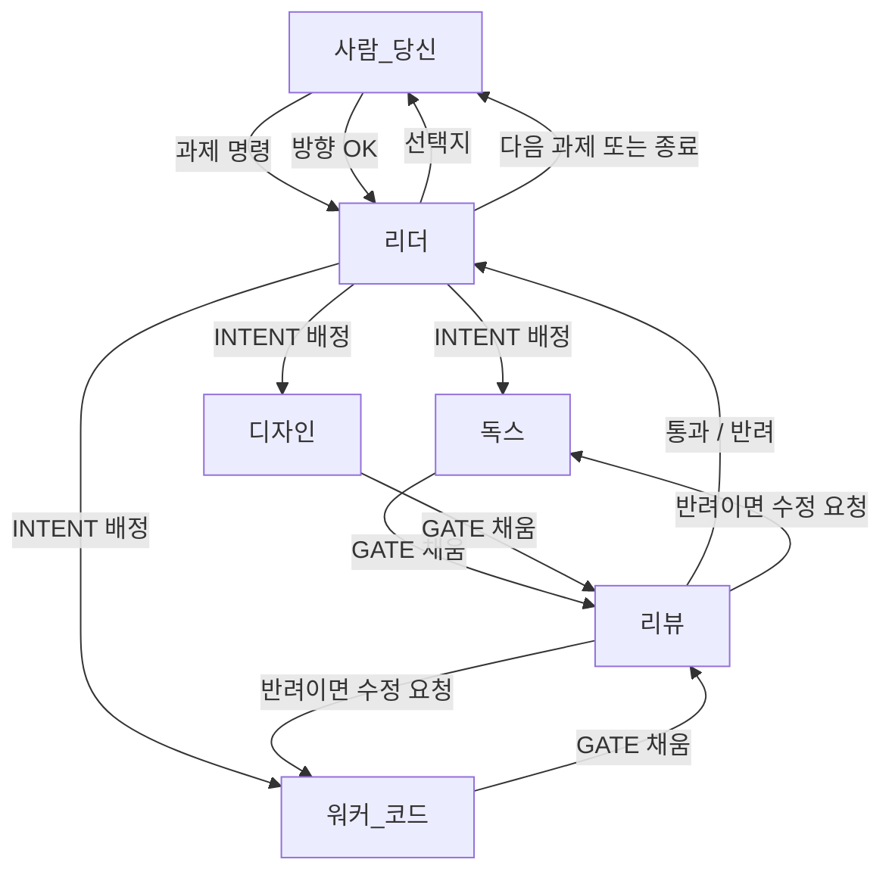
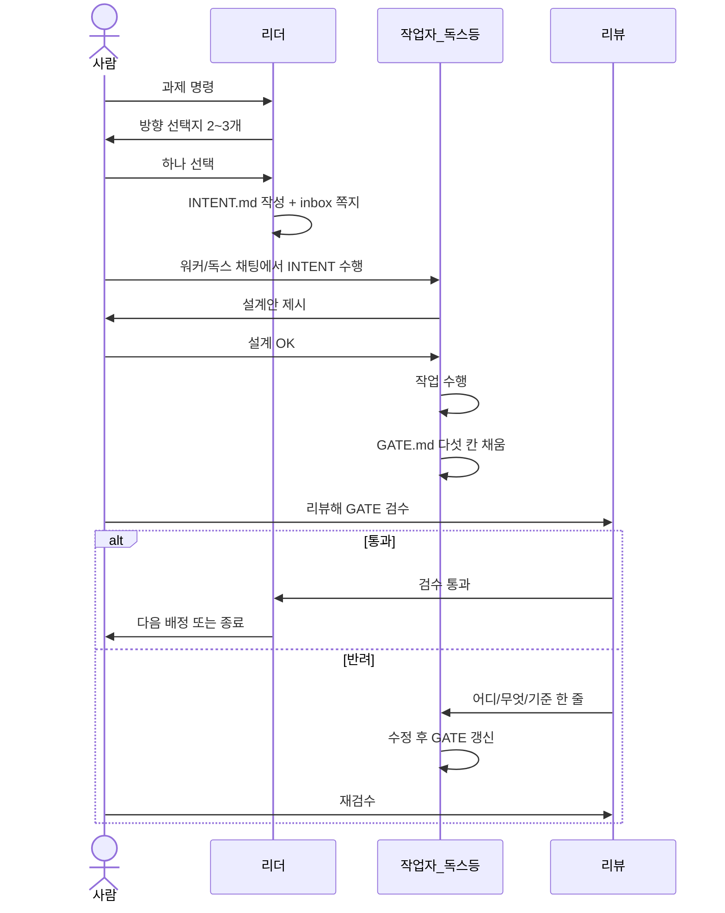
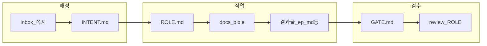
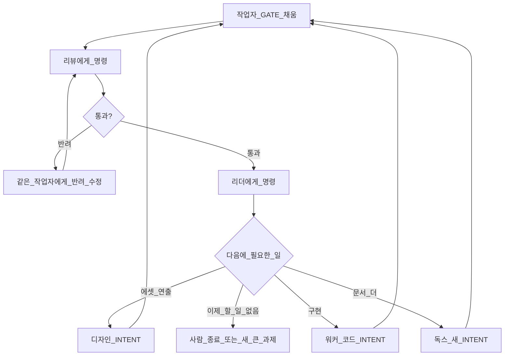

# Agent Team 가이드 — 구조 · 파일 · GATE

이 문서는 **누가 무엇을 읽고, 무엇을 쓰며, GATE가 뭔지**를 한곳에 모은 설명서다.  
짧은 사용법만 필요하면 [`README.md`](README.md).

**작업 끝났을 때 다음에 누구한테 뭐라고 할지** → [§6](#6-작업이-끝나면--다음에-누구에게-무슨-명령)

---

## 1. 한 줄로

| 말 | 의미 |
|----|------|
| **INTENT** | “이번에 뭘 하라”는 **작업 지시서** (리더가 씀 → 워커/독스/디자인이 읽음) |
| **GATE** | “일 끝났으니 **스스로 체크리스트를 채운 성적표**” (작업자가 씀 → 리뷰가 검수) |
| **inbox** | 채팅끼리 안 이어질 때 남기는 **쪽지함** (배정·반려·완료 알림) |
| **ROLE.md** | 그 역할의 **할 일 / 하지 말 일** |
| **HANDBOOK** | 팀 전체 **정식 규칙** |
| **MEMORY** | 짧은 **실수·교훈 메모** (반복되면 HANDBOOK으로 승격) |
| **HISTORY** | 모든 역할의 **진행 이력** (날짜·시간순, 맨 아래 append) |

**“GATE를 채웠다”** = 작업이 끝났다고 주장하면서, 아래 다섯 칸에  
`pass` / `fail` / `n/a` 와 짧은 근거를 **본인이 적어 둔 상태**다.  
아직 리뷰 통과가 아니다. **제출용 자기점검표**에 가깝다.

---

## 2. 전체 구조 (도식)

### 2.1 사람 ↔ 역할



### 2.2 한 과제 타임라인



### 2.3 파일로 이어지는 흐름



---

## 3. GATE란? (“채웠다”의 의미)

### 3.1 비유

공사 끝난 뒤 업자가 스스로 적는 **인수인계 체크리스트**다.

- 작업자: “테스트는 해당 없음(n/a), 문서는 맞음(pass), 보고는 이렇다”
- 리뷰: 그 표를 **다시 보고** 진짜인지 확인 → 통과 or 반려

독스가 문서만 쓴 과제에서는 테스트·화면 칸이 `n/a`인 것이 정상이다.  
예: [`roles/worker/queue/20261025-ep-opening-d30/GATE.md`](roles/worker/queue/20261025-ep-opening-d30/GATE.md)

### 3.2 다섯 칸

| 칸 | 묻는 것 | pass 예 | n/a 예 |
|----|---------|---------|--------|
| **테스트** | Playtest smoke 돌렸나 | smoke 통과 | 문서만 변경 |
| **린트/키** | Loc 키 대칭인가 | `check_loc_keys` OK | Loc 안 건드림 |
| **화면** | Unity에서 봤나 | 스크린샷·Play 확인 | UI/에셋 미변경 |
| **문서** | bible·INTENT와 모순 없나 | 링크·ID 일치 | (거의 항상 채움) |
| **보고** | 뭐 바꿨고 뭐가 남았나 | 파일 목록·리스크 | — |

### 3.3 누가 쓰나 / 누가 읽나

| | 쓰는 사람 | 읽는 사람 |
|--|-----------|-----------|
| GATE 표 본문 | **작업자** (독스·워커·디자인) | **리뷰** → 그다음 **리더**·사람 |
| 반려 칸 | **리뷰** (또는 리더) | 작업자 |

작업자가 GATE를 안 채우면 리뷰는 “끝났는지” 기준으로 삼을 파일이 없다.

---

## 4. 역할별 — 읽는 파일 / 하는 일 / 쓰는 파일

### 4.1 리더 (Leader)

| | |
|--|--|
| **역할** | 과제를 쪼개고, 사람에게 방향을 묻고, **INTENT로 배정**. 직접 코딩·장문 문서 작성은 안 함. |
| **주로 읽음** | 사람 명령, [`HANDBOOK.md`](HANDBOOK.md), [`HISTORY.md`](HISTORY.md) 최근, [`MEMORY.md`](MEMORY.md), 관련 [`../bible/`](../bible/) |
| **주로 씀** | `roles/worker/queue/<id>/INTENT.md`, 빈 `GATE.md` 복사, [`inbox/`](inbox/) 배정 쪽지 |
| **Cursor** | “리더로 동작” + `@docs/team/roles/leader/ROLE.md` |

### 4.2 독스 (Docs)

| | |
|--|--|
| **역할** | 바이블·에피소드 md·템플릿만 작성/수정. **C#·Unity 안 건드림.** |
| **주로 읽음** | 자기 [`roles/docs/ROLE.md`](roles/docs/ROLE.md), **배정된 INTENT**, bible, 기존 episodes |
| **주로 씀** | `docs/episodes/`, `docs/bible/`(해당 시), 템플릿, 과제 폴더의 **GATE.md** |
| **Cursor** | “독스로 동작” + `@…/INTENT.md` |

### 4.3 워커 (Worker · 코드)

| | |
|--|--|
| **역할** | INTENT대로 C# / Loc / Playtest 등 **구현**. 설계 OK 전 대량 수정 금지. |
| **주로 읽음** | [`roles/worker/ROLE.md`](roles/worker/ROLE.md), INTENT, bible `05`·`08`, 기존 Episode 코드 |
| **주로 씀** | `Assets/Scripts/`, `Loc/`, Playtest, **GATE.md**, 양쪽 프로젝트 동기화 |
| **Cursor** | “워커로 동작” + `@…/INTENT.md` |

### 4.4 디자인 (Design)

| | |
|--|--|
| **역할** | 초상·배경·연출(`07_PRESENTATION`). 키잉 스크립트 실행. |
| **주로 읽음** | [`roles/design/ROLE.md`](roles/design/ROLE.md), INTENT, `06_ASSETS`, `07_PRESENTATION`, `02_CHARACTER` |
| **주로 씀** | `Portraits/`, `Backgrounds/`, 필요 시 Bootstrap 상수, **GATE.md** |
| **Cursor** | “디자인으로 동작” + `@…/INTENT.md` |

### 4.5 리뷰 (Review)

| | |
|--|--|
| **역할** | GATE·결과물을 **검수**만. 새 기능 구현 안 함. |
| **주로 읽음** | [`roles/review/ROLE.md`](roles/review/ROLE.md), **GATE.md**, 변경된 결과물(diff/문서), HANDBOOK 관문 |
| **주로 씀** | GATE 하단 **반려** 또는 inbox 반려 쪽지. 통과 시 리더/사람에게 한 줄 보고 |
| **Cursor** | “리뷰로 동작” + `@…/GATE.md` |

### 4.6 사람 (당신)

| | |
|--|--|
| **역할** | 과제 투입, 방향 선택, 설계 OK, **어느 채팅에 무엇을 @할지** 결정, 최종 수락 |
| **읽는 것** | 리더 선택지, 설계안, 리뷰 결과 |
| **쓰는 것** | 채팅 명령 (파일은 보통 안 직접 씀) |

---

## 5. 폴더·파일 카탈로그 (간략)

```text
docs/team/
├── README.md          짧은 사용법 (명령 예시)
├── GUIDE.md           ← 지금 이 파일 (구조·도식·설명)
├── HANDBOOK.md        팀 정식 규칙 + GATE 다섯 칸 기준
├── HISTORY.md         진행 이력 (시간순 append)
├── MEMORY.md          짧은 교훈 (120줄 안)
├── inbox/             역할 간 쪽지 (배정·반려·완료)
│   └── YYYYMMDD-…md
└── roles/
    ├── leader/ROLE.md
    ├── docs/ROLE.md
    ├── design/ROLE.md
    ├── review/ROLE.md
    └── worker/
        ├── ROLE.md
        ├── INTENT.template.md   빈 지시서 양식
        ├── GATE.template.md     빈 관문 양식
        └── queue/
            └── <task-id>/
                ├── INTENT.md    이번 과제 지시서 (리더 작성)
                └── GATE.md      이번 과제 성적표 (작업자 작성)
```

| 파일 | 한 줄 설명 |
|------|------------|
| `ROLE.md` | 그 역할의 직무기술서 |
| `INTENT.md` | “이 과제에서 할 일·하지 말 일·완료 정의” |
| `GATE.md` | “다 했는지 다섯 칸 자기점검 + 보고” |
| `inbox/*.md` | “○○에게 이것 보라”는 알림. 채팅이 끊겨도 남음 |
| `HANDBOOK.md` | 안 지키면 안 되는 팀 규칙 |
| `HISTORY.md` | 누가 무엇을 했는지 시간순 한 줄 이력 |
| `MEMORY.md` | 최근에 반복된 실수·주의 |
| `.cursor/rules/agent-team.mdc` | “리더/팀 모드”라고 하면 Cursor가 이 체계를 따르라는 힌트 |

게임 설정 정본은 팀이 아니라 **[`docs/bible/`](../bible/)** 이다. 팀은 “어떻게 일을 나눌지”만 담당한다.

---

## 6. 작업이 끝나면 → 다음에 누구에게, 무슨 명령?

**규칙 한 줄:** GATE를 채운 작업자(독스·워커·디자인) 다음은 항상 **리뷰**.  
리뷰가 끝난 뒤에야 **리더**에게 가서 다음 배정을 받는다.



### 6.1 빠른 표 (지금 끝난 사람 → 다음)

| 방금 끝난 사람 | 당신이 다음에 명령할 대상 | 목적 |
|----------------|---------------------------|------|
| **리더** (INTENT·inbox 작성 끝) | **독스 / 워커 / 디자인** 중 INTENT에 적힌 역할 | 실제 작업 수행 |
| **독스** (GATE 채움) | **리뷰** | 문서·GATE 검수 |
| **워커** (GATE 채움) | **리뷰** | 코드·Loc·GATE 검수 |
| **디자인** (GATE 채움) | **리뷰** | 에셋·연출·GATE 검수 |
| **리뷰** · **반려** | **방금 그 작업자** (독스/워커/디자인) | GATE·반려 보고 수정 |
| **리뷰** · **통과** | **리더** | 다음 INTENT 배정 또는 종료 |
| **리더** (다음 배정 끝) | 표 맨 위처럼 **해당 작업자** | 새 INTENT 수행 |

독스만 끝난 에피소드 초안 예시 (`ep_opening`):  
독스 → **리뷰** → (통과) → **리더** → 보통 **워커**(C#/Loc) 또는 더 문서 필요하면 독스.

### 6.2 상황별 복붙 명령

아래 `<task-id>` 자리에 예: `20261025-ep-opening-d30`

---

#### A. 리더가 배정을 막 끝냄 → 작업자

INTENT의 `role` 칸을 보고 고른다.

**독스**

```text
독스로 동작. @docs/team/roles/docs/ROLE.md
이 INTENT 수행:
@docs/team/roles/worker/queue/<task-id>/INTENT.md
```

**워커(코드)**

```text
워커로 동작. @docs/team/roles/worker/ROLE.md
이 INTENT 수행:
@docs/team/roles/worker/queue/<task-id>/INTENT.md
설계 OK 받기 전엔 대량 코드 수정하지 마.
```

**디자인**

```text
디자인으로 동작. @docs/team/roles/design/ROLE.md
이 INTENT 수행:
@docs/team/roles/worker/queue/<task-id>/INTENT.md
```

---

#### B. 작업자(독스/워커/디자인)가 GATE 채움 → 리뷰

```text
리뷰로 동작. @docs/team/roles/review/ROLE.md
이 GATE 검수해:
@docs/team/roles/worker/queue/<task-id>/GATE.md
필요하면 INTENT·결과물도 같이 봐:
@docs/team/roles/worker/queue/<task-id>/INTENT.md
```

---

#### C. 리뷰가 반려 → 같은 작업자

```text
(독스|워커|디자인)로 동작. 역할 ROLE.md 따라.
반려 반영해서 수정하고 GATE 갱신해:
@docs/team/roles/worker/queue/<task-id>/GATE.md
(반려 내용이 inbox에 있으면 그것도 @)
```

고친 뒤 다시 **B (리뷰)** 로.

---

#### D. 리뷰 통과 → **리더** (여기가 정답)

리뷰가 끝나면 다음 사람은 **워커가 아니라 리더**다.  
리뷰는 배정권이 없고, 리더가 “구현할지 / 에셋할지 / 끝낼지” 선택지를 준 뒤 새 INTENT를 만든다.

**지금 `ep_opening` 리뷰 통과했다면** → 리더 채팅에 이것만 붙여넣으면 된다:

```text
리더로 동작. @docs/team/roles/leader/ROLE.md
과제 20261025-ep-opening-d30 리뷰 통과했어.
- GATE: @docs/team/roles/worker/queue/20261025-ep-opening-d30/GATE.md
- INTENT: @docs/team/roles/worker/queue/20261025-ep-opening-d30/INTENT.md
코딩하지 말고, 다음에 필요한 일 선택지 2~3개 준 뒤 새 INTENT를 배정해.
(후보 예: Loc+C# 워커 / 초상·배경 디자인 / 문서 보완 독스 / 여기서 종료)
```

리더가 새 `queue/<새-id>/INTENT.md`를 쓰면 → 다시 **A** (그 INTENT의 역할에게).

리뷰 채팅은 검수 끝에 **위와 같은 ‘다음 순서 + 복붙’을 반드시 출력**해야 한다 → [`roles/review/ROLE.md`](roles/review/ROLE.md).
---

#### E. 맨 처음 (큰 과제 시작) → 리더

```text
리더로 동작. @docs/team/roles/leader/ROLE.md
과제: (원하는 일 한 줄~여러 줄)
코딩하지 말고 선택지 준 뒤 INTENT 배정해.
```

---

### 6.3 하지 말 것

| 하지 말 것 | 이유 |
|------------|------|
| 독스 끝나자마자 워커에게 구현 명령 | GATE·리뷰 없이 문서가 흔들리면 구현이 헛수고 |
| 리뷰 없이 리더에게만 “다음 구현” | 검수 생략. 급하면 리더가 검수 겸해도 된다고 **명시**할 것 |
| 리뷰 통과 후 아무에게나 새 일 | 범위·INTENT 없이 시키면 팀이 깨짐 → **리더가 배정** |

---

## 7. Cursor 채팅 복붙 예시 (역할 시작용)

§6.2가 “다음 사람”용이다. 여기는 역할만 켤 때.

**리더**

```text
리더로 동작. @docs/team/roles/leader/ROLE.md
과제: …
```

**독스**

```text
독스로 동작. @docs/team/roles/docs/ROLE.md
이 INTENT 수행: @docs/team/roles/worker/queue/<task-id>/INTENT.md
```

**워커**

```text
워커로 동작. @docs/team/roles/worker/ROLE.md
이 INTENT 수행: @docs/team/roles/worker/queue/<task-id>/INTENT.md
```

**리뷰**

```text
리뷰로 동작. @docs/team/roles/review/ROLE.md
GATE 검수: @docs/team/roles/worker/queue/<task-id>/GATE.md
```
